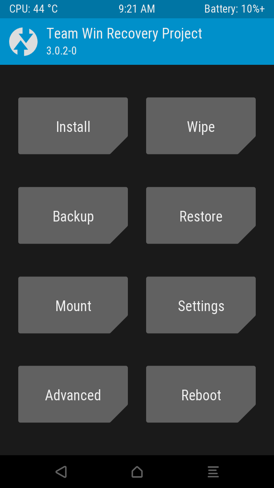

# TWRP for Acer Iconia One 7 B1-780

Unofficial persistent TWRP 3.0.2-0 recovery for the **Acer Iconia One 7 B1-780 Wi-Fi** (`acer_barricadewifi`, MediaTek MT8163). The release image was pulled back from the tested tablet after installation and verified byte-for-byte.

## Device compatibility

- Acer model: B1-780 Wi-Fi
- Platform: MediaTek MT8163
- Tested stock base: Android 6, `WW_GEN1`
- Recovery partition size: 16 MiB

Do not flash this image on B1-790, LTE variants, or another MediaTek device.

## How it works

The B1-780 needs its stock recovery environment to initialize the display and touch hardware reliably. This image is a 16 MiB bootstrap recovery: the stock recovery screen may appear for about eight seconds, then TWRP 3.0.2-0 starts automatically. This delay is expected.

## Installation

See [docs/INSTALL.md](docs/INSTALL.md). The bootloader must be unlocked first; unlocking erases user data.

## Building

The device tree is in `device/acer/acer_barricadewifi`. The scripts in `scripts/` assemble the runtime payload and the final bootstrap image. They expect the original Acer recovery image and a built TWRP tree; proprietary Acer files are not stored in this repository.

## Status

- Display and touch: working
- ADB in recovery: working
- System, data and cache mounting: working
- Persistent recovery boot: working
- MTP: hardware dependent; ADB transfer is recommended

This is an unofficial community build. Keep a copy of the stock recovery and your full backup before flashing.

The tested LineageOS 13 port is published separately in [svesnav/acer-b1-780-lineageos-13](https://github.com/svesnav/acer-b1-780-lineageos-13).
